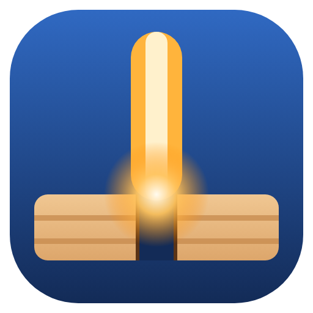

# SkyKerf_Studio

[](https://github.com/skysyndicatecorner/SkyKerf-Studio/actions/workflows/ci.yml)
[](https://github.com/skysyndicatecorner/SkyKerf-Studio/actions/workflows/build.yml)
[](LICENSE)

Открытая CAD/CAM-программа для лазерных граверов и фрезерных ЧПУ. Одно окно в стиле современных слайсеров: **CAD → CAM → проверка G-code → станок**. Русский и английский интерфейс, простой и профессиональный режимы.

*Open-source CAD/CAM for laser cutters and CNC routers. English summary below.*

> Проект раньше назывался **Kerf Studio**. Версия 0.3 открывает старые проекты `.kerf` и переносит настройки автоматически, ничего не удаляя. Подробности — [docs/RENAME.md](docs/RENAME.md).



## Что нового в 0.3.1

- **Домики:** 14 стилей (деревенский, русская изба, японский чайный, современный, A-фрейм, фахверк, готика, голландский пряничный, сказочный, новогодний, крепость, башня, амбар, sci-fi) × 8 назначений (декор, чайный домик, шкатулка, органайзер, копилка, скворечник, кормушка, светильник); два назначения можно совместить. Каждую деталь можно поменять: крыша (двускатная, мансардная, вальмовая, односкатная, плоская, зубцы), фронтон (треугольный, ступенчатый, фигурный), кровля, резные карнизы и причелины, украшение конька, труба, отделка стен, узоры, окна (10 форм × 8 переплётов), ставни и наличники, двери, двор с заборчиком.
- **Рамки и таблички:** 18 форм рамки и 16 форм окна, коллажи (ряды × столбцы), 15 узоров по краю, уголки, мотивы, украшение сверху, надписи сверху и снизу любым шрифтом, фото «в карман» или «в щель сверху», подставка, петля, отверстия или магниты.
- **Импорт:** CorelDRAW CDR (версии 6–X8 и новее, в том числе сжатые), PDF и PDF-совместимый AI, HPGL/PLT, LightBurn LBRN/LBRN2, SVGZ; SVG открывается в десятки раз быстрее.
- **Проходы и свои значения в авто-режиме:** количество проходов, интервал заливки и другие параметры можно задать самому поверх профиля материала — у таких полей появляется метка «своё» и кнопка возврата.
- **Шрифты с компьютера:** программа находит все шрифты, установленные в системе и у пользователя, плюс папки, которые вы добавите; поиск, фильтр и предпросмотр.
- **Значок станка:** функции только для лазера или только для фрезера помечены значком; нажатие предлагает переключиться на подходящий станок.
- **Исправлено:** контекстное меню холста (кнопки снова работают в Windows), тест мощности (сетка мощность × скорость или мощность × проходы).

Подробности — [CHANGELOG.md](CHANGELOG.md), форматы — [docs/IMPORT_FORMATS.md](docs/IMPORT_FORMATS.md).

## Что нового в 0.3

- **Стабильность:** история изменений с понятными названиями шагов, горячие клавиши на любой раскладке (Ctrl+Z работает и на русской), автосохранение и восстановление после аварийного закрытия, локальный журнал ошибок, списки без ограничения длины.
- **Листы:** у каждого листа свой размер, материал, толщина, поля и **запретные зоны**; удаление листа доступно в простом режиме и предлагает, что сделать с деталями.
- **Единая раскладка** для мастеров, слайсера, импорта и ручного запуска: «один лист», «несколько листов», «только текущий», «вручную»; закреплённые детали, вложение в отверстия, отчёт до применения, сравнение и сохранение вариантов, проверка пересечений, выхода за лист и дубликатов.
- **Экспорт G-code** через постпроцессоры: GRBL лазер/фрезер и консервативные общие профили, свои версионные профили, мм/дюймы, расширение, ASCII, проверка кода с номерами строк, отчёт и производственный пакет (G-code + SVG + DXF + отчёт + настройки). Все профили честно помечены «не проверено», пока их не испытали на станке.
- **Лазер:** явные типы процессов слоя (резка, векторная гравировка, заливка, растр, разметка, направляющие), сторона компенсации реза, порядок «авто/вручную», объединение мелких сегментов, оценка времени с ускорениями, растр с реальным предпросмотром строк.
- **Материалы:** библиотека с поиском, созданием, импортом/экспортом, статусами «не проверено / пользовательский / проверено» (с условиями теста), параметрами под конкретный станок и калибровкой керфа и посадки.
- **Импорт:** перетаскивание файлов и вставка из буфера; SVG, DXF, PNG, JPEG, BMP, WebP, TIFF, STL, OBJ, G-code; трассировка ч/б и по цветам с повторной трассировкой из сохранённого оригинала.
- **Текст:** системные шрифты, межбуквенный и межстрочный интервал, выравнивание, текст по дуге, предупреждение об отсутствующих шрифтах.
- **Генератор строений:** дом, чайный домик, башня, крепость, sci-fi модуль — стены с шипами, перекрытия, крыши, окна, двери, декор, спецификация, шаги сборки и 3D-просмотр; тесты керфа и посадки соединения.
- **Фрезер:** 3D-рельеф из фото (черновая + чистовая), библиотека фрез, разрезка крупных деталей на части с замками.
- **Станок:** чтение сведений контроллера (`$I`, `$$`) и черновой профиль с подтверждением неизвестных полей, статус, журнал обмена, переподключение. Подключение никогда не запускает обработку.

Полный список — [CHANGELOG.md](CHANGELOG.md).

## Скачать

Готовые сборки — на странице [Releases](https://github.com/skysyndicatecorner/SkyKerf-Studio/releases):

| Система | Файл |
|---|---|
| Windows 10/11 x64 | `SkyKerf_Studio-Setup-<версия>.exe` (установщик) или `SkyKerf_Studio-Portable-<версия>.exe` (без установки) |
| Linux x64 | `SkyKerf_Studio-<версия>-x86_64.AppImage` или `SkyKerf_Studio-<версия>-amd64.deb` (Ubuntu, Debian, Mint) |

- Windows может показать SmartScreen: сборка не подписана сертификатом. «Подробнее» → «Выполнить в любом случае».
- AppImage: `chmod +x SkyKerf_Studio-*.AppImage` и запустить.
- Linux и USB: `sudo usermod -aG dialout $USER`, затем перезайти в систему.
- **macOS** официально не собирается. Код кроссплатформенный (Electron) — порты приветствуются, см. [CONTRIBUTING.md](CONTRIBUTING.md).

## Сборка

- **Через GitHub, без установки чего-либо:** пошаговая инструкция — [docs/BUILD_GITHUB.ru.md](docs/BUILD_GITHUB.ru.md).
- **У себя:** Node.js 22+.

```bash
npm install
npm test             # модульные тесты: геометрия, раскладка, постпроцессоры, миграция
npm start            # запуск из исходников (F12 — инструменты разработчика)
npm run dist:win     # Windows → dist/*.exe
npm run dist:linux   # Linux → dist/*.AppImage, dist/*.deb
```

## Документация

| Файл | О чём |
|---|---|
| [docs/BUILD_GITHUB.ru.md](docs/BUILD_GITHUB.ru.md) | Полная инструкция по сборке через GitHub Actions |
| [docs/RENAME.md](docs/RENAME.md) | Переименование Kerf Studio → SkyKerf_Studio: репозиторий, ссылки, миграция |
| [docs/AUDIT.md](docs/AUDIT.md) | Аудит версии 0.2: найденные проблемы и что исправлено |
| [docs/POSTPROCESSORS.md](docs/POSTPROCESSORS.md) | Постпроцессоры, проверка кода, как испытать профиль на станке |
| [docs/MATERIALS.md](docs/MATERIALS.md) | Библиотека материалов, статусы, калибровка |
| [docs/IMPORT_FORMATS.md](docs/IMPORT_FORMATS.md) | Форматы импорта и что проверено |
| [docs/HOTKEYS.md](docs/HOTKEYS.md) | Горячие клавиши |
| [docs/TESTING.md](docs/TESTING.md) | Автотесты и ручные сценарии приёмки |
| [SECURITY.md](SECURITY.md) | Безопасность ПО и работы со станком |

## Структура

```
main.js, preload.js     оболочка Electron: окно, файлы, автосохранение, журнал, выбор USB-порта
src/index.html, app.css интерфейс
src/js/core.js          модель проекта (формат 3), история, миграция, общие элементы
src/js/geom.js          геометрия, смещения, булевы операции, проверки
src/js/materials.js     материалы, профили процессов, фрезы
src/js/fontname.js      имена шрифтов из файлов TTF/OTF/TTC/WOFF
src/js/text.js          шрифты и текст
src/js/nest.js          раскладка, варианты, проверка геометрии
src/js/cam.js           траектории лазера и фрезера, симуляция G-code
src/js/post.js          постпроцессоры, проверка кода, экспорт
src/js/cdr.js           чтение CorelDRAW CDR
src/js/vecformats.js    чтение PDF/AI, HPGL/PLT, LightBurn
src/js/imports.js       импорт файлов, фото, трассировка
src/js/cad.js           холст, листы, инструменты, контекстное меню
src/js/decor.js         формы, узоры, мотивы, текстуры для генераторов
src/js/gen.js           генераторы (коробки, пазлы, тесты…)
src/js/houses.js        генератор домиков: стиль × назначение
src/js/decorgen.js      рамки для фото и таблички
src/js/slicer.js        3D-модель → слои
src/js/relief.js        3D-рельеф для фрезера
src/js/devices.js       подключение станка, определение контроллера
src/js/help.js, ui.js, dialogs.js, app.js   справка, панели, диалоги, события
tests/                  модульные тесты (node --test)
```

## Безопасность

Лазер и фрезер опасны. Работайте в защитных очках под длину волны лазера, с вытяжкой, не оставляйте станок без присмотра. Никогда не режьте лазером ПВХ, винил, поликарбонат и ABS. Встроенные режимы материалов — стартовые значения: сначала тест на обрезке. Проверка кода в программе не заменяет холостой прогон и аппаратную аварийную кнопку. Программа предоставляется «как есть» (см. лицензию).

## Лицензия

Код SkyKerf_Studio — [MIT](LICENSE). Сторонние библиотеки и шрифты сохраняют свои лицензии — список в [THIRD_PARTY_NOTICES.md](THIRD_PARTY_NOTICES.md), полные тексты в [licenses](licenses).

---

## English

**SkyKerf_Studio** (formerly Kerf Studio) is an MIT-licensed CAD/CAM app for laser engravers/cutters and CNC routers: drawing on real sheets with no-go zones, one shared nesting engine (one sheet / several sheets / current sheet / manual, with reports and saved variants), postprocessor-based G-code export with validation and production packages, explicit laser process types and kerf compensation, a material library with verification statuses and per-machine values, drag-and-drop import (SVG, DXF, PNG, JPEG, BMP, WebP, TIFF, STL, OBJ, G-code) with colour tracing, system fonts and text on an arc, parametric buildings and boxes with fit profiles, 3D relief for routers, and GRBL machine control with read-only controller detection.

- **New in 0.3.1:** a house generator with 14 styles × 8 uses (tea house, box, organizer, piggy bank, birdhouse, feeder, lantern; two can be combined) and every detail adjustable; photo frames and signs with many shapes, borders, corners and any installed font; import of CorelDRAW CDR (v6–X8+), PDF / PDF-compatible AI, HPGL/PLT, LightBurn and SVGZ (see [docs/IMPORT_FORMATS.md](docs/IMPORT_FORMATS.md)); passes and other values can be overridden in auto mode; all fonts on the computer; laser-only / router-only badges; fixed context menu on Windows and the power test.
- **Download:** Releases — Windows installer/portable `.exe`, Linux `.AppImage`/`.deb`.
- **Build on GitHub:** see [docs/BUILD_GITHUB.ru.md](docs/BUILD_GITHUB.ru.md) (Russian) — in short: Actions → *Build desktop* → *Run workflow*, or publish a Release.
- **Build locally:** Node.js 22+, `npm install`, `npm test`, `npm start`, `npm run dist:win` / `npm run dist:linux`.
- **Old projects:** `.kerf` files from Kerf Studio 0.1–0.2 open and are converted; settings are copied, never deleted.
- **Honesty about hardware:** no postprocessor or material profile is marked verified until someone tests it on a real machine — please send reports via *Issues → Machine or postprocessor test report*.
